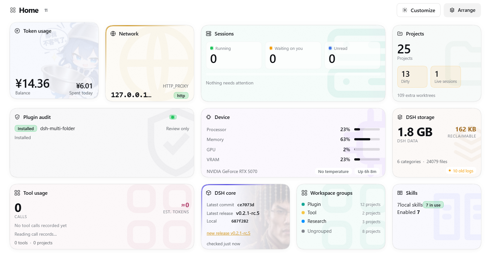

# dsh-homepage

[](https://www.npmjs.com/package/dsh-homepage)
[](LICENSE)
[](package.json)
[](package.json)

[English](README.md) | [简体中文](README.zh.md)

`dsh-homepage` gives DSH one place to browse and enter its auxiliary features. It adds an
extra surface to DSH that presents different content as cards, and a card expands to offer
entry points to those features — reviewing and installing an external plugin through a
delegated session, checking the DSH core version and updating it in one click, seeing
whether sessions are running, managing local Skills, and more. The cards are modular by
design, so any external plugin can register its own; their artwork, layout and motion can
all be customized into a personal home page.



## Install

Installing through npm is recommended:

```bash
dsh plugin --profile web add dsh-homepage
```

You can also give a DSH session the address of this repository and ask the agent to
complete the installation.

## Requirements

- **Node.js >= 22.19**
- **DSH 0.2.x**

## Cards

Eleven cards ship: the preview shows the readings, expanding opens the full view. Click a
card to float it over the wall, drag its title to reorder, and use **Customize** for
artwork, visibility and motion.

| Card | What it does |
| --- | --- |
| **Plugin audit** | Runs a session to review a given plugin for security. It can be asked to install automatically after a passing review, or to return the review report only. |
| **Sessions** | How many sessions are running, waiting on you or unread, each with a shortcut into it. |
| **Projects** | Every workspace's branch, dirty count, ahead/behind, last commit, session count and extra worktrees. |
| **Tool usage** | Tool call counts, error rate, argument and output volume, estimated tokens and time, filterable by project. |
| **Token usage** | Balance and today's spend, with history, wallets, bonus credit and account links. |
| **Network** | A quick view of the DSH core's network environment variables. |
| **Device** | CPU, memory, GPU/VRAM and disk. |
| **DSH storage** | The DSH home's size, what is reclaimable, the largest categories and old-log cleanup. |
| **DSH core** | The latest version in the DSH repository against the installed core, with a one-click update. |
| **Workspace groups** | Manage the sidebar groups. |
| **Skills** | Browse and manage installed Skills, and discover and install community Skills. |

## Extending the cards

Any other plugin can add cards through the interface. The full interface documentation is
in **[docs/card-api.md](docs/card-api.md)**.

## Model-facing tool

The plugin provides a model-callable `homepage` tool that reads the same data as the cards.
It is **off by default** and has to be turned on manually in the plugin's settings on the
Plugins page. Enabling the tool injects its context into a session: the tool can reach the
information of every card, including cards implemented by external plugins, and depending
on a card's implementation that may hand the agent information it did not expect.

## Storage

The plugin stores its data under `<DSH_HOME>/storages/dsh-homepage`. `<DSH_HOME>` prefers
the `DSH_HOME` environment variable; when that variable is absent, `~/.dsh` is used.

## Contributing

Issues and pull requests are welcome. The development loop, the repository layout and the
checks a change has to pass are in [CONTRIBUTING.md](CONTRIBUTING.md).

## License

MIT — see [LICENSE](LICENSE). Copyright (c) 2026 Yutong Zou.
