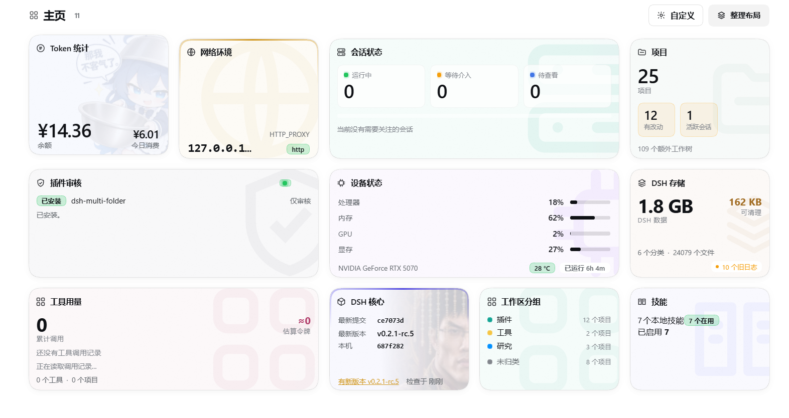

# dsh-homepage

[](https://www.npmjs.com/package/dsh-homepage)
[](LICENSE)
[](package.json)
[](package.json)

[English](README.md) | [简体中文](README.zh.md)

`dsh-homepage` 为 DSH 提供了一系列辅助功能的集中浏览与入口。插件向 DSH 提供了一个额外的界面，其中以卡片的形式展示不同的内容。卡片可以展开并提供一些功能的入口。这包括对委托会话对外部插件进行审核与安装、检查 DSH 核心版本与一键更新、查看会话的运行状态、管理本地Skill等。插件制作了模块化的设计，以便为任何外部插件提供注册卡片的接口。同时，卡片的外观、布局、动效都可以通过自定义来实现定制化的个人主页布局。



## 安装

推荐通过 npm 进行安装：

```bash
dsh plugin --profile web add dsh-homepage
```

你也可以将本仓库的地址提供给一个 DSH 的会话并要求 Agent 完成安装。

## 运行要求

- **Node.js >= 22.19**
- **DSH 0.2.x**

## 卡片

内置十一张卡片：预览态给读数，展开后是完整视图。点开卡片浮到墙上，拖标题可排序，
「自定义」调整图案、可见性与动效。

| 卡片 | 作用                                        |
| --- |-------------------------------------------|
| **插件审核** | 创建一个会话对指定插件进行安全性审核。可以要求审核通过后自动安装或者仅获取审核报告 |
| **会话状态** | 显示当前 DSH 核心运行中、等待介入、待查看的会话数量及快捷既进入        |
| **项目** | 显示每个工作区的分支、改动数、领先/落后、最近提交、会话数与额外工作树       |
| **工具用量** | 统计工具调用次数、出错率、参数与输出体积、估算 token 与耗时，可按项目筛选  |
| **Token 统计** | 余额与今日消费，含历史、钱包、赠送额度与账号链接。                 |
| **网络环境** | 快捷查看 DSH 核心的网络环境变量                        |
| **设备状态** | CPU、内存、GPU/显存与磁盘                          |
| **DSH 存储** | DSH 主目录体积、可清理量、最大类别与旧日志清理。                |
| **DSH 核心** | 检查 DSH 仓库的最新版本与当前的 DSH 核心版本，并提供一键更新       |
| **工作区分组** | 管理侧边栏分组                                   |
| **技能** | 浏览与管理已装技能以及社区技能的发现与安装                     |

## 拓展卡片

任何其他插件都可以通过接口增加新的卡片。详细接口文档见 **[docs/card-api.md](docs/card-api.md)**。

## 模型可调用工具

插件提供一个模型可调用的 `homepage` 工具，读取与卡片相同的数据。它是**默认关闭**的，需要在
插件页打开插件设置进行手动启用。启用工具会为会话注入工具上下文，工具可以访问包括外部插件实现卡片在内的所有卡片信息，这可能会基于卡片的具体实现向 Agent 提供预期外的信息，

## 数据与存储

插件在 `<DSH_HOME>/storages/dsh-homepage` 目录中存储数据。其中 `<DSH_HOME>` 优先寻找环境变量 `DSH_HOME`，若不存在该变量，则会使用 `~/.dsh`。

## 参与贡献

欢迎提交 issue 与 pull request。开发流程、仓库结构与改动需要通过的检查见
[CONTRIBUTING.md](CONTRIBUTING.md)。

## License

MIT —— 见 [LICENSE](LICENSE)。Copyright (c) 2026 Yutong Zou.
